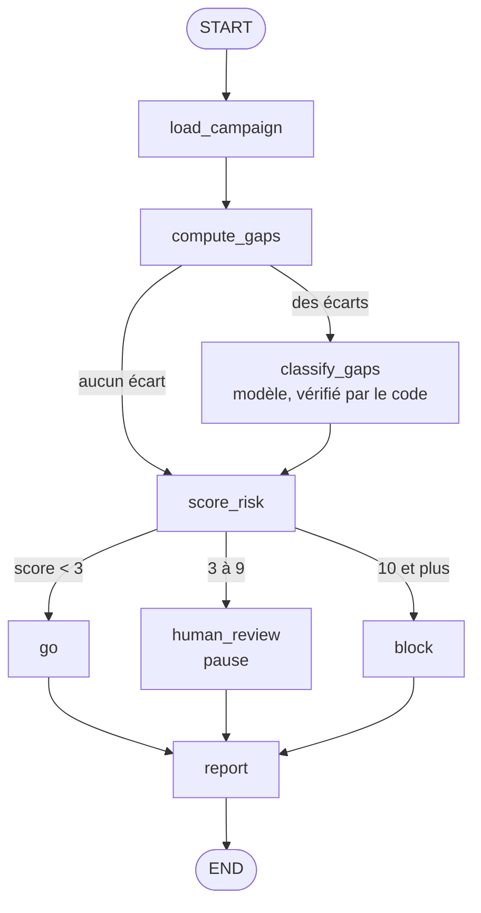
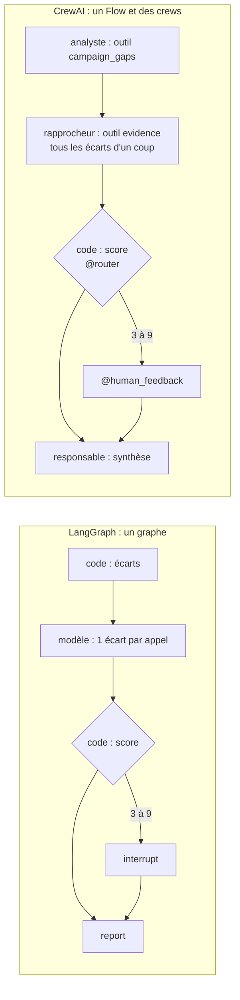

# regression-triage-agent — en bref

Un agent [LangGraph](https://github.com/langchain-ai/langgraph) qui fait le
tri d'une campagne de non-régression d'une bibliothèque de pricing bancaire,
et décide : **on livre**, **on bloque**, ou **on demande à un humain**.

*La documentation complète est en anglais : [README.md](README.md). Pour
apprendre LangGraph à partir de ce code : [docs/apprendre-langgraph.md](docs/apprendre-langgraph.md).*

**Le problème.** Avant une mise en production, la banque revalorise le même
portefeuille avec la version en production et avec la candidate. Des
centaines d'écarts sortent : bruit numérique, changement annoncé dans les
notes de version, défaut déjà connu, ou vraie régression. Un modèle de
langue sait lire une note de version ou un ticket. Il ne sait pas comparer
des nombres de façon fiable (au premier essai, il a écrit que 1,8 était
« au-dessus du seuil de 5 »), il lit aussi le texte piégé d'un ticket, et les
données d'une banque ne doivent pas sortir de chez elle.

**La réponse : le code calcule, le modèle juge, aucun chiffre n'est inventé.**

- **Code** : lecture des données, calcul des écarts en SQL, tous les nombres,
  vérification de chaque réponse du modèle, score de risque, choix du chemin,
  chiffres du mémo.
- **Modèle local** (Ollama, `qwen3.5:9b`, température 0, graine fixe) :
  rapprocher chaque écart d'une note de version ou d'un ticket, et écrire la
  phrase de synthèse du mémo.
- **Humain** : décide quand le score dit que les règles ne doivent pas
  décider seules. Le graphe se met en pause (un vrai `interrupt`), l'état est
  sauvé, et on reprend plus tard, depuis un autre processus.

**Les données ne passent que par le serveur MCP
[readonly-sql-mcp](../readonly-sql-mcp)**, lancé en sous-processus. L'agent
n'ouvre jamais la base. Et chaque nœud n'a droit qu'à ses tables : celui qui
calcule les écarts ne voit pas les tickets, celui qui classe ne voit pas les
résultats, le modèle n'a aucun outil.

**Une réponse du modèle qui ne se justifie pas devient une « nouvelle
régression ».** Un « changement attendu » doit citer une vraie note de cette
version, sur ce produit. Un « défaut connu » doit citer un ticket **ouvert**
sur ce produit. Un « bruit numérique » n'est accepté que sous 5 fois la
tolérance. Tout doute pousse vers « bloquer », jamais vers « livrer ».

**La preuve.** `pytest` (sans modèle : un faux répond) et
`python tools/mutation_check.py`, qui casse exprès chaque règle
déterministe — écarts, vérifications, score, routage, moindre privilège,
garde-fou du mémo, réglages du modèle, juge des évaluations — et exige qu'un
test rougisse.

**Les évaluations.** Huit campagnes dont on connaît la vérité, rejouées
trois fois chacune sur le vrai modèle : justesse par écart (catégorie **et**
justification), justesse de la décision, stabilité entre les runs. Les
chiffres, les échecs et leur cause : [evals/RESULTS.md](evals/RESULTS.md).

Troisième campagne (qwen3.5:9b, 8 campagnes × 3 répétitions, 176 s en
tout) : **décision juste 24/24, écarts justes 60/66** (catégorie et
justification), catégories et décision identiques d'une répétition à l'autre
dans 8 campagnes sur 8 (le texte brut, lui, varie d'un mot dans 2 sur 8).
Les 6 écarts faux sont 2 écarts, faux trois fois de la même façon : un ticket
CDS sur la *PV* cité pour un écart de *CS01*, et une obligation qui ne se
valorise plus excusée par un ticket d'affichage. Le code les a acceptés :
il vérifie qu'une citation existe, est ouverte et porte sur le bon produit,
pas de quelle métrique parle un ticket en texte libre. La première campagne
faisait 5/8 ; les deux corrections sont des règles générales, mais trouvées
sur ces huit campagnes : 24/24 est donc une mesure optimiste.

## Le même agent avec CrewAI

Pour dire **quand choisir LangGraph et quand choisir CrewAI**, chiffres à
l'appui, l'agent est écrit une seconde fois avec CrewAI
(`src/regression_triage/crew/`). Seule l'orchestration change : passerelle
MCP, écarts, contrôles, score, chemin et mémo sont le même code.

Même modèle, mêmes réglages, mêmes données, même juge, 8 campagnes × 3 :

| | LangGraph | CrewAI |
|---|---|---|
| Décisions justes | 24/24 | 24/24 |
| Écarts justes (catégorie et justification) | 60/66 | **66/66** |
| Tokens lus par le modèle | 43 323 | **88 206** |
| Durée | 172 s | 231 s |

CrewAI classe mieux ici, mais sa version pose la question autrement (tous
les écarts d'un coup) : rien ne montre que le mérite revient au framework,
la cause n'est pas établie. Il a demandé : un
environnement séparé (`crewai` exige `mcp<2`), son propre branchement à
Ollama (sa route standard plafonne le contexte à 4 096 tokens), la
télémétrie coupée de force, et un **Flow** pour router et attendre un
humain. Le détail, la table « je choisis LangGraph quand… / CrewAI
quand… » et la phrase pour l'entretien :
[docs/langgraph-vs-crewai.md](docs/langgraph-vs-crewai.md).

## Au-delà du tri : l'automatisation des tests

- **Robot Framework** pilote l'agent : `python tools/robot_xray.py` lance 8 tests (un par campagne), produit `output.xml`, `xunit.xml` et `log.html` pour un import Xray (non essayé). Voir [docs/robot-framework-et-xray.md](docs/robot-framework-et-xray.md).
- **D'une spécification fonctionnelle à un cahier de tests** : le modèle propose les cas, le code lit les règles, calcule les limites, refuse ce qu'il ne peut pas tracer, complète, et exporte au format Xray. Voir [docs/specs-vers-cas-de-test.md](docs/specs-vers-cas-de-test.md).
- **Agent desktop** : la décision du tri est saisie dans une application Windows qu'il a lancée lui-même et qu'il retrouve par son PID. Il n'a que trois gestes sur une liste blanche, relit l'écran et réessaie une fois. Non testé sur une vraie application WinDev. Voir [docs/agent-desktop.md](docs/agent-desktop.md).
- **CI GitHub Actions** (tests, mutations, version CrewAI) et **test de charge** : 5 000 écarts en 0,4 s hors modèle ; le goulot est le modèle, et la limite de 200 lignes du serveur MCP. Voir [docs/ci-et-charge.md](docs/ci-et-charge.md).
