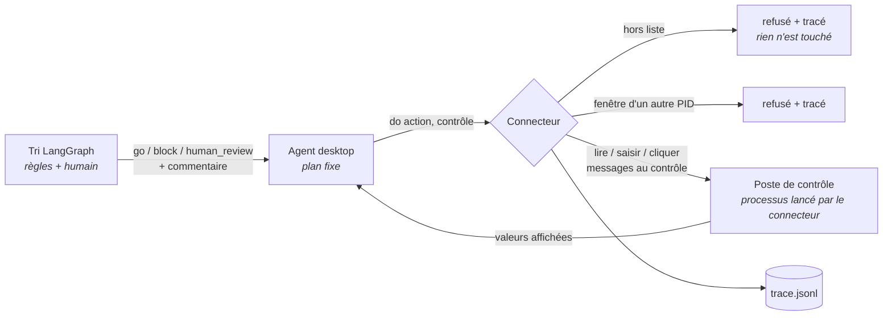
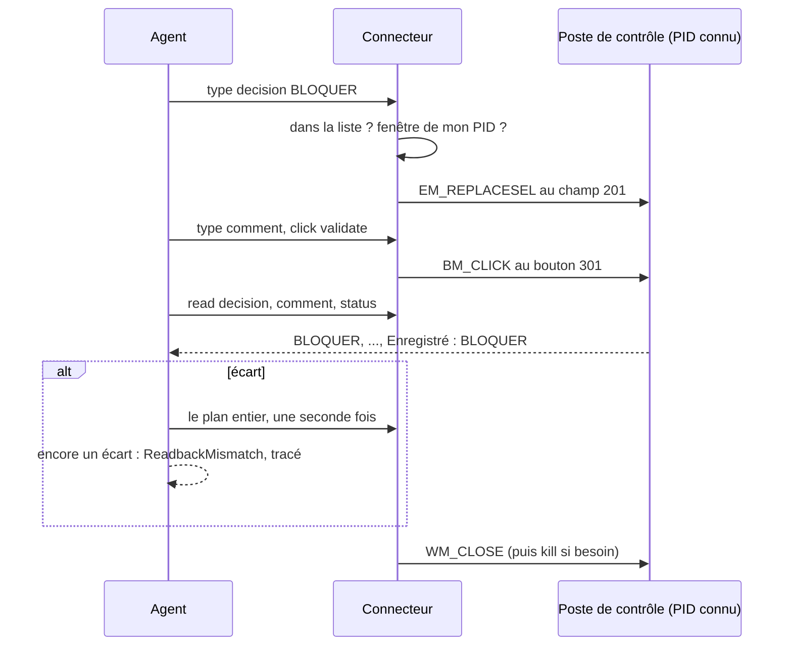

# Un agent qui pilote une application Windows, avec une liste blanche

Pour toi, S. L'agent de tri décide *go*, *block* ou *revue humaine*. Ce
module porte cette décision dans une application Windows de bureau (un
« poste de contrôle de livraison » fictif), la saisit, la valide, puis relit
l'écran pour prouver qu'elle y est arrivée.

Pourquoi : l'offre visée demande de « développer des connecteurs permettant
aux agents IA d'interagir avec des applications et des interfaces Desktop »,
en environnement Windows/WinDev. C'est la preuve, mesurée et sûre.

Code : [`src/regression_triage/desktop/`](../src/regression_triage/desktop).
Tests : [`tests/test_desktop.py`](../tests/test_desktop.py).

---

## 1. La phrase pour l'entretien

> « Mon connecteur desktop ne pilote que l'application qu'il a lancée : il
> la retrouve par son PID, jamais par un titre. Il n'a que trois gestes,
> lire, saisir, cliquer, sur des contrôles nommés, et tout le reste est
> refusé par le code et tracé. Aucune frappe ni aucun clic ne passe par le
> clavier ou la souris de l'utilisateur. Après chaque saisie il relit
> l'écran ; s'il y a un écart il réessaie une fois, puis il échoue
> proprement, et l'application est fermée dans tous les cas. Le plan est
> écrit dans le code : le modèle ne choisit aucune action. »

Si on te demande « et WinDev ? » : pywinauto verrait une application
WinDev comme une application win32 (des fenêtres Windows avec des
contrôles). C'est le cas de mon application de démo. **Je ne l'ai pas
testé sur une vraie application WinDev**, faute d'en avoir une.

---

## 2. Un exemple d'abord : la campagne 7

Ce que fait la démo. Les étapes 2 à 5 sont prouvées par les tests
d'interface ; la commande entière, avec le vrai modèle, n'a pas encore été
lancée (section 9).

```powershell
cd "Z:\Dynas Code\Dynas\labo\regression-triage-agent"; $env:PYTHONPATH="src"; .venv\Scripts\python -m regression_triage.desktop 7 --hold 3
```

1. Le tri tourne comme `run 7 --no-input` : deux régressions de vega, la
   règle dit *block*.
2. Le connecteur lance le poste de contrôle (`Campagne 7`, `Écarts : 2`),
   garde le PID du processus, et attache la fenêtre de **ce** processus.
3. L'agent déroule son plan fixe : saisir `BLOQUER` dans *Décision*, le
   commentaire dans *Commentaire*, cliquer *Valider*, relire les deux
   champs et la ligne de statut.
4. Le statut dit `Enregistré : BLOQUER` : c'est fini, en une tentative.
5. L'application est fermée. Chaque geste est une ligne de
   `runs/<thread>/trace.jsonl` (nœuds `desktop.*`), à la suite des nœuds
   du tri.

Une campagne qui demande un humain (4, 6) est saisie `REVUE HUMAINE` : le
poste reçoit l'attente, l'agent ne tranche jamais à la place de l'humain.

---

## 3. Le principe et les barrières

Le principe du projet ne change pas : **le code route et vérifie**. Ici le
modèle ne fait même pas le jugement : la décision vient du tri, déjà prise.



| Barrière | Comment | Prouvé par |
|---|---|---|
| **Seulement l'application lancée** | le connecteur démarre le processus et garde son PID ; `attach(pid)` refuse tout autre PID ; la fenêtre est cherchée *dans ce processus* par sa classe, jamais par un titre ; avant chaque geste, le code revérifie que la fenêtre appartient toujours à ce PID | `test_a_second_instance_with_the_same_title_is_never_driven` : une 2ᵉ instance, même programme, même titre, lancée avant par un autre chemin, n'est jamais attachée ni modifiée ; sans fenêtre : `test_attach_refuses_any_process_but_its_own` |
| **Liste blanche** | `ALLOWED` : lire `campaign`, `gaps`, `status`, `decision`, `comment` ; saisir `decision`, `comment` ; cliquer `validate`. Rien d'autre | `test_the_whitelist_is_exactly_this` (la liste figée, comme les périmètres MCP) ; 8 refus paramétrés |
| **Refus avant tout contact** | la liste est vérifiée avant même de chercher la fenêtre ; le refus est une ligne `refused` de la trace | `test_a_refused_action_is_traced_before_anything_is_touched` (sans fenêtre) et le même sur la vraie application |
| **Pas de clavier ni de souris** | saisir = `EM_REPLACESEL` (win32) ou `ValuePattern.SetValue` (UIA) envoyé **au champ** ; cliquer = `BM_CLICK` envoyé **au bouton** (win32) ou `Invoke` (UIA). Jamais `send_keys`, `type_keys`, `click_input` : ils passent par le clavier et la souris de l'utilisateur, ils ne sont pas dans la liste | `send_keys` et `click_input` sont refusés par les tests |
| **Fermeture garantie** | gestionnaire de contexte : `WM_CLOSE` à la fenêtre, puis le processus est tué s'il ne part pas ; aussi en cas d'exception | `test_the_app_is_closed_even_when_the_work_fails`, `test_an_app_that_ignores_the_close_request_is_killed` ; sans fenêtre : `test_the_process_is_stopped_even_when_the_work_fails` |
| **Relecture** | après *Valider*, l'agent relit décision, commentaire et statut ; un écart → une seule nouvelle tentative → échec `ReadbackMismatch` | `test_a_gap_at_the_read_back_fails_after_one_retry` (l'application est truquée pour réécrire le champ) |



### Le rôle du modèle : aucun, et pourquoi

Le seul endroit où un modèle aurait pu servir : traduire le mot du tri
(`block`) en mot de l'application (`BLOQUER`). Avec trois valeurs fermées,
une table le fait exactement, à chaque fois, et un test la fige
(`test_the_labels_are_exactly_these`). Un modèle n'ajouterait qu'une façon
de se tromper. Sur une vraie application avec des centaines de libellés, le
modèle pourrait proposer une correspondance, mais le code n'accepterait
qu'une valeur de la liste fermée de l'application, et la relecture
vérifierait le résultat : le même schéma que les citations du tri.

---

## 4. Pourquoi pas tkinter : mesuré

La consigne demandait tkinter. Sonde faite sur la machine (Tk 8.6,
pywinauto 0.6.9), une fenêtre avec un label, un champ, un bouton nommés :

| | `win32` | `uia` |
|---|---|---|
| Label | `Static`, texte **vide** | `Image`, nom **vide** |
| Champ (`Entry`) | `TkChild`, pas de valeur | `Pane`, pas de valeur |
| Bouton | `Button`, texte **vide** | `Button`, nom **vide** |
| Nom Tk (`name="decision"`) | invisible | invisible |

Tk 8.6 dessine lui-même ses widgets : vus de l'extérieur, ce sont des
rectangles sans nom ni valeur. Il n'y a rien à lire, donc rien à vérifier.

L'application de démo est donc écrite en **contrôles Win32 natifs**
(`EDIT`, `BUTTON`, `STATIC`) avec `ctypes`, de la bibliothèque standard
aussi. Chaque contrôle a un identifiant fixe (101, 102, 201, 202, 301,
401) : `control_id` pour win32, `auto_id` pour UIA. C'est la forme la plus
robuste, et la plus proche de ce que serait une application WinDev.

Un piège rencontré : sous Windows, le `python.exe` d'un environnement
virtuel est un **lanceur** qui démarre le vrai interpréteur en processus
enfant. La fenêtre appartient alors à un PID que le connecteur n'a jamais
vu, et il refuse, à juste titre. Le connecteur lance donc l'application
avec le vrai interpréteur (`sys._base_executable`), et un test le fige.

---

## 5. `uia` ou `win32`

pywinauto a deux façons de voir une fenêtre. Le connecteur sait faire les
deux (`--backend`), et le test de saisie tourne avec les deux.

| | `win32` | `uia` (UI Automation) |
|---|---|---|
| Ce que c'est | l'API Windows historique : fenêtres (HWND), classes, messages | la couche d'accessibilité de Windows (celle des lecteurs d'écran) |
| Trouver un contrôle | `control_id`, classe, texte | `auto_id`, type de contrôle, nom |
| Lire un champ | `WM_GETTEXT` : le texte du champ | `ValuePattern` : la valeur. **Le nom d'un champ est son label** (« Décision »), pas son contenu |
| Saisir | `EM_REPLACESEL` au champ | `ValuePattern.SetValue` |
| Cliquer | `BM_CLICK` au bouton, synchrone | `InvokePattern.Invoke`, qui peut être asynchrone |
| Voit | Win32, MFC, VB6, Delphi, **WinDev** (en principe) | tout ce qui expose l'accessibilité : WPF, WinForms, UWP, Qt, navigateurs, Win32 aussi |
| Ne voit pas | WPF, UWP, Qt : un seul rectangle | ce qui n'expose rien (Tk 8.6, ci-dessus) |
| Vitesse | rapide | plus lent (COM, arbre d'accessibilité) |

Un piège de pywinauto 0.6.9 en `uia` : `set_edit_text` calcule le nouveau
texte à partir de `window_text()`, qui est le **nom** du champ (son label),
pas sa valeur. Ça tombe juste par hasard ; le connecteur appelle
`ValuePattern.SetValue` directement.

Règle : `win32` pour une application Win32 classique (messages directs,
synchrones) ; `uia` pour WPF, WinForms moderne ou quand `win32` ne voit
qu'un rectangle.

---

## 6. Et une application WinDev ?

**Non testé, faute d'application WinDev.**

Ce qu'on peut en dire : une application WinDev est un exécutable Windows
natif dont les fenêtres et les champs sont des fenêtres Windows (HWND).
pywinauto la verrait donc comme une application `win32`, comme la démo.
Ce qu'il faudrait vérifier sur une vraie :

1. Les classes des champs (WinDev dessine certains champs lui-même) :
   `print_control_identifiers()` avec les deux backends, comme la sonde
   tkinter de la section 4.
2. Des identifiants stables d'une version à l'autre : sinon, trouver le
   champ par son label voisin en UIA.
3. Si un champ ne répond pas à `WM_GETTEXT`/`EM_REPLACESEL`, essayer
   `uia`, puis, en dernier recours, une API ou un export de l'application
   plutôt que l'écran.

Le connecteur ne change pas : seuls la table `CONTROLS` (noms →
identifiants) et le lancement changent.

---

## 7. Les commandes

Depuis le dépôt, avec le venv du projet.

Les tests d'interface **ne tournent pas par défaut** : un `pytest` ou un
`mutation_check` ordinaire n'ouvre aucune fenêtre (ils sont sautés avec la
raison « set RUN_GUI_TESTS=1 »). Quand on les demande, l'application
s'ouvre **hors écran** (`--offscreen` : position -30000, fenêtre outil sans
bouton de barre des tâches, affichée sans prendre le focus). pywinauto la
pilote là comme ailleurs : elle reste une fenêtre visible pour Windows.

```powershell
cd "Z:\Dynas Code\Dynas\labo\regression-triage-agent"; .venv\Scripts\python -m pytest -q tests/test_desktop.py
cd "Z:\Dynas Code\Dynas\labo\regression-triage-agent"; $env:RUN_GUI_TESTS="1"; .venv\Scripts\python -m pytest -q tests/test_desktop.py; Remove-Item Env:RUN_GUI_TESTS
cd "Z:\Dynas Code\Dynas\labo\regression-triage-agent"; $env:PYTHONPATH="src"; .venv\Scripts\python -m regression_triage demo
cd "Z:\Dynas Code\Dynas\labo\regression-triage-agent"; $env:PYTHONPATH="src"; .venv\Scripts\python -m regression_triage.desktop 7 --hold 3
cd "Z:\Dynas Code\Dynas\labo\regression-triage-agent"; $env:PYTHONPATH="src"; .venv\Scripts\python -m regression_triage.desktop 4 --backend uia
cd "Z:\Dynas Code\Dynas\labo\regression-triage-agent"; .venv\Scripts\python src\regression_triage\desktop\demo_app.py --campaign 4 --gaps 2
```

La dernière ouvre l'application seule, pour la regarder. Code de sortie
de la démo : 0 saisi et relu, 2 erreur ou écart à la relecture.

---

## 8. Ce que ça prouve, ce que ça ne prouve pas

Mesures : voir la section 9 (tests, durées, mutations).

**Limites :**

- **Une application de démo, écrite pour l'occasion.** Elle a des
  identifiants stables et des contrôles natifs : le cas facile. Une vraie
  application peut dessiner ses champs, changer ses identifiants, ouvrir
  des boîtes de dialogue modales : rien de tout cela n'est couvert.
- **Pas de WinDev réel** (section 6).
- **Un bureau interactif est nécessaire, et il faut le demander.** Les
  tests d'interface ne tournent qu'avec `RUN_GUI_TESTS=1`, sous Windows,
  avec un bureau interactif déverrouillé ; ils sont sautés dans le CI
  (Linux), dans une session de service et sur un écran verrouillé. Les
  tests sans fenêtre (liste blanche, refus, plan, relecture avec une fausse
  application, attache et fermeture sur un processus sans fenêtre)
  tournent partout et attrapent à eux seuls les 10 mutations du module.
- **Le mode hors écran n'est pas invisible pour Windows.** La fenêtre est
  hors de tout écran, sans focus ni bouton de barre des tâches, mais elle
  existe (Alt+Tab peut la montrer). La démo en ligne de commande, elle,
  s'ouvre à l'écran : on la lance pour la regarder.
- **Le PID est la frontière.** Un autre programme du même utilisateur
  pourrait toujours, lui, modifier la fenêtre : le connecteur garantit ce
  que *lui* fait, pas ce que font les autres. Il ne suit pas non plus les
  processus enfants : une application qui ouvre sa fenêtre dans un
  sous-processus serait refusée (c'est voulu).
- **`Invoke` en UIA peut être asynchrone.** Le connecteur attend que
  l'application ait répondu à un message avant de relire ; si un clic
  arrivait après la relecture, l'écart déclencherait la nouvelle
  tentative, visible dans la trace.
- **Rien n'est relu en dehors de la ligne de statut et des deux champs.**
  Une application qui afficherait « Enregistré » sans enregistrer
  tromperait l'agent : la vraie preuve serait de relire la donnée
  enregistrée (base, export), pas l'écran.

---

## 9. Mesures

Le 10/11/2026, Windows 11, Python 3.12.10, pywinauto 0.6.9.

| | Résultat |
|---|---|
| `pytest` complet, sans `RUN_GUI_TESTS` | **165 verts, 8 sautés** (143 d'avant + 22 sans fenêtre), aucune fenêtre ouverte |
| `tests/test_desktop.py` avec `RUN_GUI_TESTS=1`, hors écran | **30 verts** en 17,6 s, aucune instance restée ouverte |
| Saisie + relecture, `win32` | 0,32 s |
| Saisie + relecture, `uia` | 14,8 s (cause non établie : vraisemblablement l'initialisation COM d'UI Automation, non mesurée à part) |
| Mutations du module (liste, attache, fermeture, lanceur, relance, relecture, libellés) | **10/10 attrapées, par les seuls tests sans fenêtre** |
| Stabilité, avant le mode hors écran | 20 passages verts sur 21 ; **un échec du test `uia`, non reproduit**, dont la sortie n'a pas été gardée. Cause inconnue |

La démo en ligne de commande avec le vrai modèle n'a pas été lancée : elle
ouvre la fenêtre à l'écran.
