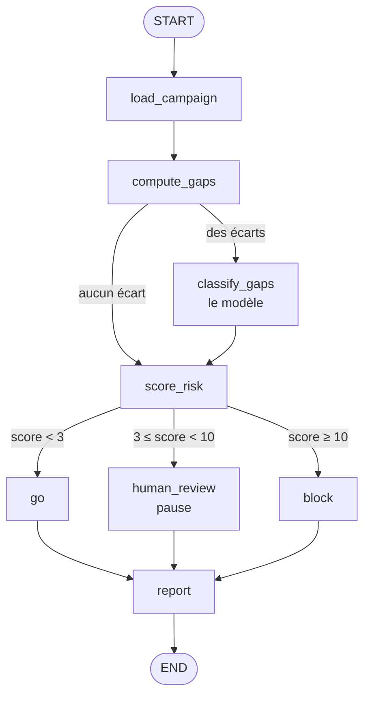
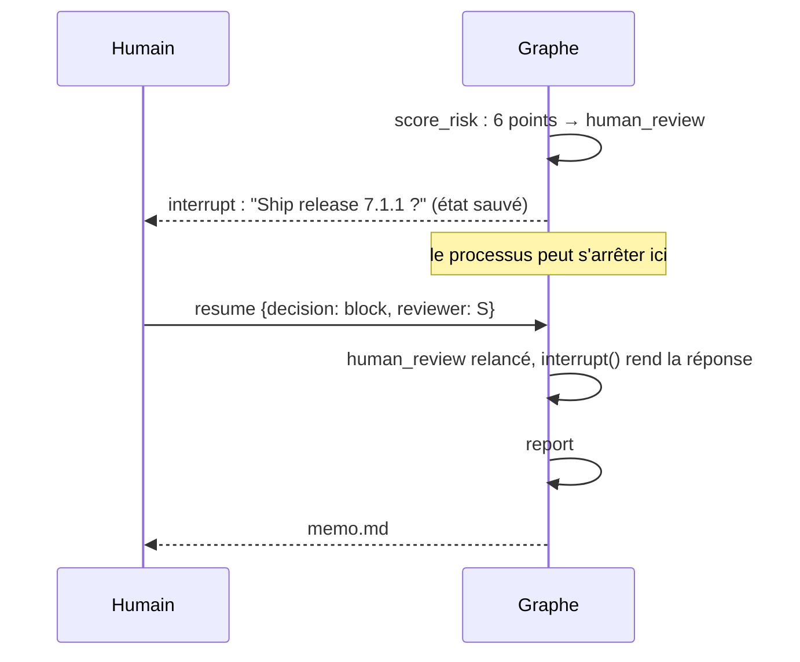

# Apprendre LangGraph avec ce projet

Pour toi, S. Tu connais déjà le principe : tu orchestres des sous-agents
Claude Code, avec des gates, des skills versionnés, un `/next` qui enchaîne
des sprints et un `STATE.json` qui garde l'état. LangGraph, c'est la même
idée, écrite en Python. Ce qui change, c'est la syntaxe.

À chaque fois : **d'abord l'exemple du projet, ensuite le nom.**

---

## 1. Ce que tu fais déjà ↔ le nom LangGraph

| Ce que tu fais déjà | Le nom LangGraph | Ici, dans le projet |
|---|---|---|
| `chantiers/<nom>/STATE.json` : l'état du chantier, relu à chaque étape | **State** | `TriageState` dans `graph.py` |
| Un sprint : une étape qui lit l'état et rend un résultat | **Nœud** (node) | `compute_gaps`, `score_risk`… |
| `/next` passe au sprint suivant | **Arête** (edge) | `add_edge("classify_gaps", "score_risk")` |
| Une gate : selon le résultat, on continue ou on s'arrête | **Arête conditionnelle** | `after_score` → `go` / `block` / `human_review` |
| Gate SPEC : tu attends que S valide avant de coder | **interrupt** | le nœud `human_review` |
| `/relais save` : figer l'état pour reprendre ailleurs | **Checkpointer** | `AsyncSqliteSaver` dans `runner.py` |
| Le nom du chantier, pour savoir quel état reprendre | **thread_id** | `c4-20261109-210000` |
| Un sous-agent qui n'a droit qu'à certains outils | moindre privilège (pas un concept LangGraph : on le code) | `SCOPES` dans `gateway.py` |

---

## 2. Le graphe du projet, en une image



Un seul nœud parle au modèle pour juger (`classify_gaps`). Un seul lui
demande du texte (`report`). Tout le reste, c'est du code.

---

## 3. Le State

**Exemple.** Voici l'état de ce projet :

```python
class TriageState(TypedDict, total=False):
    campaign_id: int
    campaign: dict
    gaps: list[dict]
    classifications: list[dict]
    risk: dict
    decision: dict
    summary: dict
    memo: str
```

Au départ, il ne contient qu'une chose : `{"campaign_id": 4}`. Chaque nœud
ajoute sa part. `compute_gaps` remplit `gaps`. `score_risk` remplit `risk`.
À la fin, `memo` contient le mémo.

**Définition.** Le **State**, c'est le dictionnaire partagé que les nœuds se
passent. Comme ton `STATE.json` : chaque étape le lit, et écrit seulement ce
qu'elle a produit. `total=False` veut dire : les clés arrivent au fur et à
mesure, elles ne sont pas toutes là dès le début.

---

## 4. Le nœud

**Exemple.** Le nœud qui calcule le score :

```python
async def score_risk_node(state: TriageState) -> dict:
    return {"risk": score(state["gaps"], state.get("classifications", []))}
```

Il lit `gaps` et `classifications` dans l'état. Il rend **un petit
dictionnaire** : `{"risk": ...}`. Il ne rend pas tout l'état.

**Définition.** Un **nœud** est une fonction : elle reçoit l'état, elle rend
une **mise à jour**. LangGraph fusionne cette mise à jour dans l'état. C'est
comme un sprint qui écrit seulement sa ligne dans `STATE.json`.

On l'enregistre avec un nom :

```python
graph.add_node("score_risk", score_risk_node)
```

---

## 5. L'arête

**Exemple.**

```python
graph.add_edge(START, "load_campaign")
graph.add_edge("load_campaign", "compute_gaps")
graph.add_edge("classify_gaps", "score_risk")
graph.add_edge("report", END)
```

Après `load_campaign`, on va **toujours** à `compute_gaps`.

**Définition.** Une **arête** dit « après ce nœud, va à celui-là ». `START`
et `END` sont deux nœuds spéciaux : l'entrée et la sortie. C'est ton `/next`
quand il n'y a qu'un seul sprint possible après.

---

## 6. L'arête conditionnelle

**Exemple.** Après le score, trois chemins :

```python
def after_score(state: TriageState) -> str:
    return state["risk"]["route"]          # "go", "block" ou "human_review"

graph.add_conditional_edges("score_risk", after_score, ["go", "block", "human_review"])
```

`after_score` lit l'état et rend **le nom du nœud suivant**. Si le score vaut
6, `route` vaut `"human_review"`, donc le graphe va au nœud `human_review`.

Il y en a une deuxième, plus haut :

```python
def after_gaps(state: TriageState) -> str:
    return "classify_gaps" if state["gaps"] else "score_risk"
```

Pas d'écart ? On saute le modèle. La campagne 1 ne l'appelle jamais.

**Définition.** Une **arête conditionnelle** est une fonction de routage :
elle regarde l'état et choisit la suite. C'est une gate. Point important ici :
**cette fonction est du code, pas le modèle**. Le modèle ne choisit jamais le
chemin. Il donne des catégories ; le code en fait un score ; le score fait
la route.

La liste `["go", "block", "human_review"]` dit les chemins possibles : elle
sert à dessiner le graphe, et une route hors de la liste fait échouer le run
(vérifié : une fonction qui rend `"zzz"` lève `KeyError`).

---

## 7. L'interrupt

**Exemple.** Le nœud `human_review` :

```python
async def human_review_node(state: TriageState) -> dict:
    question = {"question": f"Ship release {state['campaign']['candidate_release']}?", ...}
    while True:
        answer = interrupt(question)
        problem = check_human_answer(answer)
        if problem is None:
            break
        question = {**question, "error": problem}
    return {"decision": {"final": answer["decision"], "decided_by": "human", ...}}
```

Ce qui se passe, dans l'ordre :

1. Le graphe arrive dans `human_review`.
2. `interrupt(question)` **arrête tout**. L'état est sauvé sur disque.
   L'appel `ainvoke` rend la main, avec la question dans `state["__interrupt__"]`.
3. Le programme peut s'arrêter. Des heures plus tard :
   ```
   python -m regression_triage resume c4-20261109-210000 --decision block --reviewer "S" --comment "on attend le correctif"
   ```
4. LangGraph relance le nœud **depuis le début**. Cette fois, `interrupt(...)`
   ne s'arrête pas : il **rend la réponse** de l'humain.
5. Si la réponse est invalide (« ship it » au lieu de `go`/`block`), la boucle
   rappelle `interrupt` : le graphe se remet en pause et redemande.



**Définition.** **interrupt** met le graphe en pause au milieu d'un nœud et
attend une valeur venue de l'extérieur. On reprend avec
`Command(resume=valeur)`. C'est ta gate SPEC : rien ne continue tant que S
n'a pas tranché.

Attention au piège : à la reprise, **le nœud repart du début**. Tout ce qui
est avant `interrupt` est exécuté deux fois. Ici, il n'y a rien de coûteux
avant : seulement la construction de la question.

---

## 8. Le checkpointer et le thread_id

**Exemple.** Dans `runner.py` :

```python
async with AsyncSqliteSaver.from_conn_string("runs/checkpoints.sqlite") as saver:
    graph = build_graph(bank, judge, tracer, saver)
    config = {"configurable": {"thread_id": "c4-20261109-210000"}}
    state = await graph.ainvoke({"campaign_id": 4}, config)          # démarre
    ...
    state = await graph.ainvoke(Command(resume=answer), config)      # reprend
```

Le test `test_the_pause_survives_the_process` le prouve : on démarre avec
une connexion et un modèle, on reprend avec **d'autres**, et seul le fichier
de checkpoints est partagé. À la reprise, aucune requête n'est refaite vers
la base de la banque.

**Définition.** Le **checkpointer** sauve l'état après chaque nœud.
Le **thread_id** dit quel état reprendre, comme le nom du chantier dit quel
`STATE.json` relire. Sans checkpointer, pas d'interrupt possible : il n'y
aurait rien à reprendre.

Le fichier de checkpoints contient l'état de l'agent (écarts, catégories,
score), pas une copie de la base.

---

## 9. Compiler et lancer

**Exemple.**

```python
graph = StateGraph(TriageState)          # 1. on déclare la forme de l'état
graph.add_node("score_risk", ...)        # 2. on ajoute les nœuds
graph.add_edge(...)                      # 3. on les relie
app = graph.compile(checkpointer=saver)  # 4. on fige le tout
await app.ainvoke({"campaign_id": 4}, config)
```

**Définition.** `StateGraph` est le plan. `compile()` le vérifie (une arête
vers un nœud inconnu : erreur) et rend un objet qu'on peut lancer. Il ne
vérifie pas tout : un nœud que rien n'atteint passe sans erreur. `ainvoke` est la version asynchrone d'`invoke` : ici tous les
nœuds sont `async`, parce que l'appel au serveur MCP et au modèle le sont.

---

## 10. Ce qui n'est pas LangGraph, mais qui fait le projet

LangGraph ne fournit que le squelette. Le reste est du code ordinaire, et
c'est lui qui rend l'agent fiable :

| Règle | Où | Prouvée par |
|---|---|---|
| Le code calcule tous les nombres (écart, tolérance, ratio, petit/grand) | `campaign.py`, `judge.gap_prompt` | `test_gaps.py`, `test_judge.py` |
| Le modèle n'a aucun outil | `judge.py` (pas de `tools=`) | `test_judge.py` |
| Chaque nœud n'a que ses tables | `gateway.SCOPES` | `test_privileges.py`, `test_graph.py` |
| Une réponse non justifiable devient « nouvelle régression » | `risk.check_classification` | `test_risk.py` |
| Le texte du mémo ne peut pas inventer de chiffre | `report.check_summary` | `test_graph.py` |
| Chaque règle cassée exprès fait rougir un test | `tools/mutation_check.py` | lui-même |

C'est la même idée que tes gates : le modèle propose, quelque chose de
déterministe vérifie.

---

## 11. Pour aller plus loin, dans l'ordre

1. Lis `graph.py` en entier : 150 lignes, tout y est.
2. Lance `pytest tests/test_graph.py -q` : chaque test est un scénario.
3. Lance `python -m regression_triage run 4` et réponds à la question.
4. Ouvre `runs/<thread>/trace.jsonl` : une ligne par nœud, dont une
   `interrupted` puis une `ok` pour `human_review`.
5. Change un seuil dans `risk.py`, relance `python tools/mutation_check.py` :
   regarde quel test rougit.
