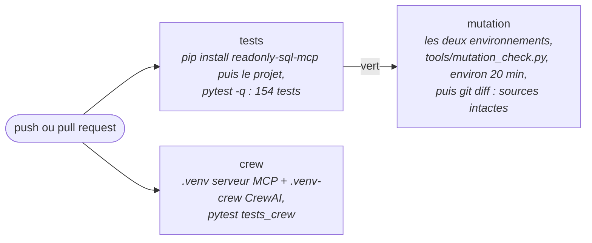

# Intégration continue et test de charge

Deux questions qu'un recruteur pose à un dépôt public : *est-ce que ça se
vérifie tout seul à chaque modification ?* et *qu'est-ce que ça devient avec
dix fois plus de données ?* Ce document répond aux deux, avec ce qui a été
mesuré et ce qui ne l'a pas été.

## 1. La CI : `.github/workflows/ci.yml`

Elle se lance à chaque `push`, chaque `pull_request`, et à la demande
(`workflow_dispatch`). Ubuntu, Python 3.12, cache pip. **Aucun secret, aucun
modèle** : tous les tests utilisent un faux juge ou un faux client Ollama, et
`OLLAMA_HOST` pointe sur un port fermé, de sorte qu'un test qui tenterait de
joindre un vrai modèle échouerait tout de suite au lieu d'attendre.



| Job | Ce qu'il fait | Pourquoi comme ça |
|---|---|---|
| `tests` | installe `readonly-sql-mcp` depuis GitHub, puis le projet avec l'extra `dev`, lance `pytest -q` | `pyproject.toml` liste `readonly-sql-mcp` en dépendance ; il n'est pas sur PyPI sous ce nom, on l'installe d'abord depuis le dépôt frère |
| `mutation` | casse une à une les 60 protections du code et exige qu'un test devienne rouge ; attend que `tests` soit vert | 15 à 20 minutes : inutile de les dépenser sur une suite déjà rouge. Le script fait aussi les mutations CrewAI, donc il lui faut `.venv` et `.venv-crew` à la racine (la disposition du README). Le `git diff --exit-code` final vérifie que chaque fichier source est revenu octet pour octet |
| `crew` | deux environnements, car `crewai` exige `mcp<2` alors que le reste exige `mcp` 2 ; `pytest tests_crew` tourne dans `.venv-crew` | le serveur MCP tourne avec l'interpréteur de `.venv`, que `crew/bank.py` trouve seul (`.venv/bin/python`). Une étape vérifie que `crewai` s'importe : `tests_crew/conftest.py` **saute tout** si l'import échoue, et un job vert avec zéro test serait un faux feu vert |

L'interpréteur du serveur MCP n'est donc pas codé en dur sous Windows : il
essaie `.venv/Scripts/python.exe` puis `.venv/bin/python`, et accepte la
variable `TRIAGE_SERVER_PYTHON`. Aucun changement n'est nécessaire dans le
code pour Linux.

### Ce qui n'est pas vérifié

GitHub Actions n'a pas tourné : le YAML est valide (lu par `yaml.safe_load`),
les commandes d'installation ont été vues à sec (`pip install --dry-run`), la
suite et la mutation ont tourné sous Windows, mais **rien n'a tourné sous
Linux** avant le premier push. À regarder au premier passage : les trois jobs
verts, la durée de `mutation`, et que `pip` retrouve bien `crewai==1.15.39`.

## 2. Le test de charge

Sans modèle : un faux juge qui répond la vérité, et qui compte ses appels. Le
générateur `tools/synthetic_campaign.py` construit une campagne dont **la
réponse est connue d'avance** (combien d'écarts de quelle catégorie, sur quel
produit), avec trois résultats propres par écart pour détecter un excès de
zèle de la requête. Le banc `tools/bench.py` mesure, et
`tests/test_scale.py` vérifie la justesse. Le détail et la méthode sont dans
`evals/SCALE_RESULTS.md`.

### Les chiffres (PC de développement, Windows 11, le 10/11/2026)

| écarts | résultats | écarts via MCP | total | mémoire crête | appels au juge |
|---:|---:|---:|---:|---:|---:|
| 200 | 800 | 16 ms | 0,09 s | 1 Mo | 201 |
| 1 000 | 4 000 | 31 ms | 0,13 s | 4 Mo | 1 001 |
| 5 000 | 20 000 | 188 ms | 0,40 s | 16 Mo | 5 001 |
| 20 000 | 80 000 | 765 ms | 1,4 s | 63 Mo | 20 001 |
| 50 000 | 200 000 | 2,1 s | 3,6 s | 145 Mo | 50 001 |

### Ce que ça dit

- **Les parties déterministes ne sont pas le goulot.** 5 000 écarts en 0,4 s,
  croissance linéaire. À l'intérieur, le plus lent est le transport (la
  requête passe par MCP : lignes, JSON, dictionnaires), de 4 à 8 fois le SQL
  seul. Le score est négligeable.
- **Le goulot est le modèle.** Estimation, pas mesure, à partir de
  `evals/RESULTS.md` (90 appels, 43 k jetons, 176 s pour 66 écarts × 3) :
  un appel par écart, environ 480 jetons en entrée et 90 en sortie, 1,65 s
  chacun. 1 000 écarts : environ 28 minutes ; 5 000 écarts : environ 2 h 20.
  Contre 0,4 s pour tout le reste.
- **La justesse tient à l'échelle** : à 200, 1 000 et 5 000 écarts le code
  retrouve exactement les écarts plantés, les comptes par catégorie, le score
  et la route.

### Ce qui ne passerait pas à l'échelle

1. **Plus de 200 écarts : la campagne est refusée.** Le serveur MCP coupe à
   200 lignes par requête et l'agent s'arrête (`DataError`) plutôt que de
   trier la moitié d'une campagne. Voulu, mais c'est un mur : 200 écarts
   passent, 201 non (un test le fige). Le banc relève la limite pour mesurer ;
   en production il faudrait une option du serveur ou une lecture par pages.
2. **Le résumé du mémo déborde le contexte du modèle vers 400 écarts** : les
   faits qu'il reçoit contiennent une ligne par écart (18 jetons environ), le
   contexte est de 8 192. Estimation. À borner : les comptes, puis les pires
   écarts.
3. **Un appel de modèle par écart** coûte du temps linéaire. Regrouper par
   produit, métrique et catégorie changerait ce que le modèle voit : à
   évaluer avant, pas à supposer.
4. **L'état entier est sauvegardé après chaque nœud** (13,6 Mo pour 5 000
   écarts) et un mémo de 5 000 lignes (423 Ko) n'est lu par personne.

Rien de tout cela n'a été corrigé : ça touche des fichiers de production, et
la mesure était le sujet.

## 3. Commandes (PowerShell)

```powershell
cd regression-triage-agent; .\.venv\Scripts\python.exe -m pytest -q
cd regression-triage-agent; .\.venv\Scripts\python.exe -m pytest -q tests/test_scale.py
cd regression-triage-agent; .\.venv\Scripts\python.exe tools/bench.py
cd regression-triage-agent; .\.venv\Scripts\python.exe tools/bench.py --sizes 200 1000 5000 20000 --max-rows 100000
cd regression-triage-agent; .\.venv\Scripts\python.exe tools/synthetic_campaign.py demo\synthetic.db 1000 mixed
cd regression-triage-agent; .\.venv\Scripts\python.exe tools/mutation_check.py
```

(Le chemin est celui du dépôt une fois cette branche intégrée.) Le premier
passage de la CI se regarde dans l'onglet *Actions* du dépôt GitHub.

## 4. La phrase pour l'entretien

> « Mon agent de tri a une CI sans secret ni modèle : les tests, une
> vérification par mutation qui casse mes protections une à une, et la
> version CrewAI dans son propre environnement. Je l'ai aussi mesuré à
> l'échelle : 5 000 écarts en 0,4 seconde pour toute la partie déterministe,
> donc le goulot est le modèle (environ 2 heures à 5 000 écarts, estimé), et
> le vrai mur est ailleurs, une limite de 200 lignes du serveur que j'ai
> trouvée en mesurant. »
