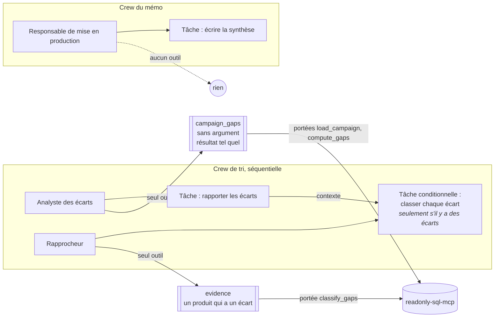

# LangGraph ou CrewAI ? Le même agent, écrit deux fois

Pour toi, S. Le même tri de campagne de non-régression, sur les mêmes
données, avec le même modèle local et le même juge d'évaluation. Une fois
avec LangGraph, une fois avec CrewAI. Seule l'orchestration change.

À chaque fois : **d'abord l'exemple du projet, ensuite la règle.**

---

## 1. La phrase pour l'entretien

> « LangGraph quand c'est le code qui choisit le chemin et qu'un humain
> doit pouvoir tout arrêter des heures ; CrewAI quand on veut vite des
> rôles qui choisissent eux-mêmes leurs outils. Sur mon agent de tri, les
> deux font 24 décisions justes sur 24, mais CrewAI lit deux fois plus de
> tokens et a besoin de son Flow, donc d'un graphe, pour router et attendre
> l'humain. »

Si on te demande « et la qualité ? » : la version CrewAI classe mieux les
écarts (66/66 contre 60/66). Elle pose la question autrement (tous les
écarts d'un coup, le modèle va chercher ses preuves) ; rien ne montre que
le mérite revient au framework, et la cause exacte n'est pas établie. Les
chiffres et les limites sont en section 6.

---

## 2. Un exemple d'abord : la campagne 4

La campagne 4 a deux écarts de vega sur des options à barrière. Un ticket
ouvert les explique. Le score vaut 6 : il faut un humain.

**Avec LangGraph**, le code fait tout dans l'ordre, et le modèle n'est
appelé que pour juger :

1. `load_campaign`, `compute_gaps` : du code lit la base par MCP.
2. `classify_gaps` : le code va chercher les notes et les tickets, puis
   pose **une question par écart** au modèle. Deux écarts, deux appels.
3. `score_risk` : le code calcule 6. Une arête conditionnelle envoie vers
   `human_review`.
4. `interrupt()` : le graphe s'arrête, l'état est sauvé. Tu réponds plus
   tard, d'un autre processus.
5. `report` : un appel au modèle pour la synthèse.

**Avec CrewAI**, trois agents ont chacun un rôle et un outil :

1. L'**analyste des écarts** appelle son outil `campaign_gaps`. Le texte de
   l'outil devient sa réponse, tel quel : il ne retape aucun chiffre.
2. Le **rapprocheur** lit cette réponse. Il décide lui-même d'appeler
   l'outil `evidence` pour le produit FXBAR, puis classe **les deux écarts
   d'un coup**.
3. Le code vérifie les deux réponses et calcule 6. Une crew ne sait pas
   choisir un chemin : c'est le **Flow** de CrewAI qui route.
4. `@human_feedback` : le Flow s'arrête, l'état est sauvé. Tu réponds plus
   tard, d'un autre processus.
5. Le **responsable de mise en production** écrit la synthèse.

Même décision, mêmes tableaux dans le mémo. Ce qui change : qui choisit quoi lire (le code
ou le modèle), combien de questions on pose au modèle, et ce qu'il faut
autour pour router et attendre un humain.

---

## 3. Les deux orchestrations côte à côte

```mermaid
flowchart LR
    subgraph LG[LangGraph : un graphe]
        direction TB
        L1[load_campaign<br/><i>code</i>] --> L2[compute_gaps<br/><i>code</i>]
        L2 -->|des écarts| L3[classify_gaps<br/><i>code lit, modèle juge<br/>1 appel par écart</i>]
        L2 -->|aucun| L4
        L3 --> L4[score_risk<br/><i>code</i>]
        L4 -->|< 3| L5[go]
        L4 -->|3 à 9| L6[human_review<br/><i>interrupt</i>]
        L4 -->|≥ 10| L7[block]
        L5 --> L8[report]
        L6 --> L8
        L7 --> L8
    end
    subgraph CR[CrewAI : un Flow autour de deux crews]
        direction TB
        C1[triage<br/><i>crew : analyste puis rapprocheur<br/>puis code : contrôle, score</i>] --> C2{route<br/><i>@router, code</i>}
        C2 -->|go, block| C3[decided_by_rules]
        C2 -->|human_review| C4[ask_reviewer<br/><i>@human_feedback : pause</i>]
        C4 --> C5{record_answer<br/><i>code lit le JSON</i>}
        C5 -->|invalide| C4
        C5 -->|valide| C6
        C3 --> C6[report<br/><i>crew : responsable<br/>puis code : garde-fou, mémo</i>]
    end
```

À gauche, **un seul concept** : un graphe de nœuds. À droite, **deux
couches** : des crews (les agents) et un Flow (le contrôle). La partie
droite du schéma, c'est déjà un graphe : on a réécrit dans le Flow ce que
LangGraph donne d'emblée.

---

## 4. La crew : agents, tâches, outils



| Agent | Outil | Portées de la passerelle | Ce qu'il ne peut pas faire |
|---|---|---|---|
| Analyste des écarts | `campaign_gaps` | `load_campaign`, `compute_gaps` | demander une autre campagne (l'outil n'a pas d'argument) ; lire les tickets |
| Rapprocheur | `evidence` | `classify_gaps` | lire les résultats ; demander un produit sans écart |
| Responsable | aucun | aucune | toucher aux données |
| le code (contrôle, score) | — | `classify_gaps` | — (c'est le code : il relit lui-même les preuves pour vérifier) |

Le moindre privilège tient sur **deux verrous** : un agent n'a que son
outil (`AGENT_TOOLS`), et un outil ne voit la banque qu'à travers ses
portées (`TOOL_SCOPES`). Donner le mauvais outil à un agent n'élargirait
donc pas ce qu'il peut lire. Les deux tables sont figées par
`tests_crew/test_crew_privileges.py`, et cinq mutations les cassent exprès.

**Processus séquentiel, pas hiérarchique.** Le mode hiérarchique ajoute un
modèle « manager » qui choisit quel agent travaille. Ici l'ordre ne change
jamais, et le modèle ne doit jamais choisir le chemin. Un manager n'aurait
ajouté que des appels et une façon de se tromper. Je ne l'ai pas mesuré.

---

## 5. Ce que CrewAI rend facile

**Exemple.** L'outil `evidence` est déclaré une fois. Le rapprocheur l'a
appelé seul, pour chaque produit, souvent en un seul message (trois appels
d'outil pour les trois produits de la campagne 2). Je n'ai écrit aucune
boucle.

**Règle.** CrewAI est fait pour ça : **des rôles, des outils, et le modèle
qui décide quoi appeler.** Autres choses qui se sont écrites en une ligne :

| Besoin | CrewAI | Ligne |
|---|---|---|
| La réponse d'un outil devient la réponse de la tâche, sans retouche | `result_as_answer=True` | `tools.py` |
| Sauter une tâche s'il n'y a rien à faire (campagne 1) | `ConditionalTask(condition=...)` | `crew.py` |
| Une réponse structurée | `output_pydantic=Classifications` | `crew.py` |
| Passer la sortie d'une tâche à la suivante | `context=[find]` | `crew.py` |
| Une pause humaine qui survit au processus | `@human_feedback` + persistance SQLite + `from_pending(...).resume(...)` | `flow.py`, `runner.py` |

La pause humaine **marche** : testée, et rejouée à la main (`run 4`,
processus arrêté, `resume` depuis un autre processus). C'est l'équivalent
du `interrupt` de LangGraph, mais dans les Flows, pas dans les crews.

---

## 6. Les chiffres

Même modèle (`qwen3.5:9b`, température 0, graine 42, sans réflexion,
contexte 8 192), même machine, mêmes 8 campagnes × 3 répétitions, même
juge. Détail : [evals/RESULTS.md](../evals/RESULTS.md).

| | LangGraph | CrewAI |
|---|---|---|
| Décisions justes | **24/24** | **24/24** |
| Écarts justes (catégorie **et** justification) | 60/66 | **66/66** |
| Catégories et décision identiques d'une répétition à l'autre | 8/8 campagnes | 8/8 campagnes |
| Texte brut identique | 6/8 | 7/8 |
| Appels au modèle | 90 (1 par écart + 1) | 90 (toujours 4, 2 sans écart) |
| Tokens lus par le modèle | 43 323 | **88 206** (×2,04) |
| Taille d'un appel qui classe | 550 tokens en moyenne | 1 659 en moyenne, 1 888 au plus |
| Durée des 24 runs | 172 s (7,2 s par run) | 231 s (9,6 s par run, ×1,34) |
| Un agent qui n'a pas fait son travail | — | 0 sur 24 |

**Ce que ça dit.**

- **Les deux prennent les bonnes décisions**, toujours les mêmes.
- **CrewAI classe mieux ici** : il réussit les deux écarts que LangGraph
  rate trois fois sur trois (le ticket CDS sur la *PV* cité pour un écart
  de *CS01* ; l'obligation qui ne se valorise plus, excusée par un ticket
  d'affichage). Le rapprocheur écrit (traduit) : *« le ticket ouvert PRC-2301
  concerne la PV, pas le CS01 »*.
- **Mais rien ne dit que c'est le framework.** Les deux versions ne posent pas la
  même question : LangGraph pose un écart à la fois avec les preuves
  choisies par le code ; la crew pose tous les écarts d'un coup, laisse le
  modèle aller chercher les preuves, et ajoute le prompt de CrewAI (rôle,
  objectif, histoire). Laquelle de ces différences corrige les deux écarts,
  je ne le sais pas. Un nœud LangGraph qui demande tous les écarts d'un
  coup trancherait ; je ne l'ai pas lancé. Et c'est toujours huit
  campagnes, sans jeu de test caché.
- **Deux fois plus de tokens pour le même nombre d'appels.** Chaque appel
  de la crew porte le prompt de l'agent, tous les écarts et les résultats
  d'outils. En local, ça coûte du temps (+34 %) ; sur une API payante, ce
  serait la facture.
- **Un appel gaspillé.** L'analyste des écarts dépense un appel au modèle
  pour appeler un outil sans argument. Sur la campagne 1, sans écart, la
  crew fait 2 appels là où le graphe en fait 1.

Le détail, campagne par campagne : [evals/RESULTS.md](../evals/RESULTS.md),
section *run 4*.

---

## 7. Ce que CrewAI rend difficile

Tout ce qui suit a été rencontré, pas lu dans une doc.

1. **Il ne cohabite pas avec ce projet.** `crewai 1.15.39` exige
   `mcp<2` ; ce projet et `readonly-sql-mcp` utilisent `mcp 2.3`. Les deux
   ne tiennent pas dans un même environnement. D'où `.venv-crew` (898 Mo
   et 145 paquets, contre 129 Mo et 69 pour LangGraph : chromadb, lancedb,
   onnxruntime, kubernetes… arrivent avec), un client MCP 1 adapté
   (`crew/bank.py`), et le serveur MCP lancé avec l'interpréteur de
   l'autre environnement.
2. **Sa route vers Ollama coupe le contexte sans prévenir.** CrewAI parle
   à Ollama par son point d'accès compatible OpenAI. Mesuré ici : ce point
   d'accès ignore `num_ctx` et sert le modèle avec **4 096 tokens** de
   contexte, et le modèle réfléchit tant qu'on ne lui dit pas
   `reasoning_effort="none"`. Un appel du rapprocheur fait jusqu'à 1 888
   tokens ici (rôle, objectif, histoire, outils, sortie de la tâche
   précédente) : sous la limite, mais la conversation grandit avec chaque
   produit, et une campagne plus grosse la dépasserait sans aucune erreur.
   J'ai écrit `crew/llm.py` (la voie documentée : hériter de
   `BaseLLM`) pour appeler Ollama exactement comme la version LangGraph.
3. **Il envoie de la télémétrie par défaut.** Anonyme, mais elle sort de la
   machine. Coupée de force au chargement (`crew/__init__.py`), et un test
   vérifie qu'elle reste coupée même si le shell dit le contraire.
4. **Une crew ne sait ni brancher ni attendre.** Elle exécute ses tâches
   dans l'ordre, point. Pour « score ≥ 10 → bloquer » et « attendre un
   humain », il faut un **Flow** : `@start`, `@router`, `@listen`,
   `@human_feedback`. C'est un second modèle mental, et c'est un graphe.
5. **La réponse humaine est une chaîne.** `resume()` ne prend qu'un texte.
   LangGraph reprend avec n'importe quelle valeur (ici un dict). Ici, la
   réponse voyage en JSON et le code la relit. Et CrewAI propose de
   transformer une réponse libre en décision **avec un modèle**
   (`emit=[...]`) : je ne l'utilise pas, le modèle ne doit jamais lire la
   décision de l'humain (un test le vérifie : à la reprise, le seul appel au
   modèle est la synthèse).
6. **L'autre revue humaine de CrewAI est moins bonne.** `Task(human_input=True)`
   bloque le processus sur `input()` dans le terminal, et ta réponse est
   envoyée **au modèle**, qui réécrit sa réponse (lu dans
   `crewai/core/providers/human_input.py`). Pas de pause qui survit au
   processus, pas de décision enregistrée telle quelle. Je ne l'ai donc pas
   prise.
7. **Les outils sont synchrones, MCP est asynchrone.** La session MCP vit
   dans son propre fil avec sa propre boucle (`BankSession`). Trente lignes
   que LangGraph n'a pas demandées.
8. **Un piège trouvé par un test.** Un outil CrewAI est un modèle pydantic :
   un champ `dict` y est **copié**. Le dossier partagé où l'outil range les
   écarts trouvés restait vide ; le test « l'analyste n'a pas appelé son
   outil » l'a montré. Corrigé avec un champ `Any`.

---

## 8. Je choisis LangGraph quand… / CrewAI quand…

| Je choisis **LangGraph** quand… | Je choisis **CrewAI** quand… |
|---|---|
| le **chemin** doit être décidé par du code, testable nœud par nœud | le chemin compte moins que le **travail de chaque rôle** |
| un **humain** doit pouvoir arrêter le processus des heures, et reprendre avec une valeur structurée | la revue humaine est un relecteur dans la boucle, ou un Flow suffit |
| je veux **une question par élément** au modèle, avec les preuves déjà choisies par le code | je veux que le modèle **choisisse lui-même** quoi lire avec ses outils |
| je compte les tokens (ici : moitié moins), ou le modèle est petit et local | les tokens comptent peu, le modèle est fort |
| le projet a déjà ses dépendances (ici `mcp 2`) | je pars de zéro et j'accepte ses dépendances |
| je dois montrer à un auditeur un **graphe figé par un test** | je dois montrer vite un prototype lisible par un métier (« rôles », « tâches ») |

Les deux font la même chose ici, avec les mêmes garde-fous, parce que les
garde-fous ne sont pas dans le framework : **ils sont dans le code autour**
(passerelle MCP, contrôle des réponses, score, garde-fou des chiffres). Le
framework choisit seulement qui appelle quoi, et dans quel ordre.

---

## 9. Pour essayer

```bash
# une fois : l'environnement CrewAI, à côté de .venv
python -m venv .venv-crew
.venv-crew/Scripts/pip install -r requirements-crew.txt
.venv-crew/Scripts/pip install --no-deps -e .

.venv-crew/Scripts/python -m regression_triage.crew run 7                 # bloque
.venv-crew/Scripts/python -m regression_triage.crew run 4 --no-input      # s'arrête, attend un humain
.venv-crew/Scripts/python -m regression_triage.crew resume <thread> --decision block --reviewer "S" --comment "PRC-2207"

.venv-crew/Scripts/python -m pytest tests_crew                            # sans modèle
.venv-crew/Scripts/python evals/run_evals.py --engine crew --reps 3       # avec le modèle
```

Sous Linux ou macOS : `bin/` au lieu de `Scripts/`.
