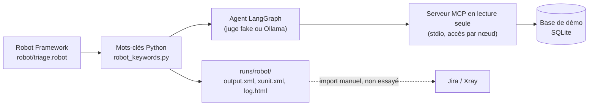

# Robot Framework pilote l'agent, et les résultats s'importent dans Xray

Ce que ce dossier prouve : une suite de tests Robot Framework lance **vraiment** l'agent de triage sur les 8 campagnes, vérifie la décision, et produit les fichiers qu'Xray sait importer. Ce qui n'est **pas** prouvé : l'import dans un Jira/Xray réel (pas de compte, pas essayé, voir plus bas).

## Les pièces

| Pièce | Rôle |
|---|---|
| `robot/triage.robot` | La suite : 8 tests écrits en phrases, un par campagne. Chacun porte des tags (`campaign-3`, `route-go`, `XRAY-DEMO-3`). Le setup construit une base de démo, le teardown vérifie qu'elle n'a pas bougé et supprime le dossier de travail. |
| `src/regression_triage/robot_keywords.py` | La bibliothèque de mots-clés (classe `TriageLibrary`). Chaque mot-clé est une fine couche sur le code existant : elle lance l'agent et rapporte, elle ne décide rien. |
| `tools/robot_xray.py` | Lance la suite et range `output.xml`, `xunit.xml`, `log.html` dans `runs/robot/` (ignoré par git). N'envoie rien nulle part. |
| `tests/test_robot_suite.py` | pytest vérifie la suite elle-même (8 passés, xunit valide, tags présents, une décision attendue faussée fait échouer Robot, et les contrôles négatifs des mots-clés). |

Mots-clés : `Prepare Triage Environment`, `Run Triage`, `Triage Route`, `Triage Decision`, `Gap Count` (par catégorie), `Gap Counts Should Match Ground Truth`, `No Write Should Have Been Attempted`, `Cleanup Triage Environment`.

Le juge se choisit par une variable Robot : `JUDGE:fake` (défaut, le faux juge déterministe des tests, aucun modèle) ou `JUDGE:ollama` (le vrai modèle local, `MODEL:qwen3.5:9b`).

Deux choses à savoir :
- La vérité terrain (ce que chaque écart planté est vraiment) vit dans `data.py`, jamais dans la base ; le mot-clé la lit là pour comparer le nombre d'écarts par catégorie.
- Pour une campagne en route `human_review`, personne ne répond (aucune entrée humaine) : la décision lue est `waiting_for_human`.
- « Aucune écriture » est vérifié de deux façons : tous les appels arrivés au serveur MCP sont des `query` faits par un nœud qui a un périmètre, et l'empreinte SHA-256 du fichier de base est identique avant et après.

## Schéma



## Commandes (PowerShell)

Le venv est partagé avec le dépôt principal ; adapter le chemin si besoin.

```powershell
# La suite complète, faux juge (aucun modèle), environ 10 s
cd "Z:\Dynas Code\Dynas\labo\rta-kb-robot"; $env:PYTHONPATH = "src"; & "Z:\Dynas Code\Dynas\labo\regression-triage-agent\.venv\Scripts\python.exe" tools\robot_xray.py

# Une seule campagne, ou une seule route
cd "Z:\Dynas Code\Dynas\labo\rta-kb-robot"; $env:PYTHONPATH = "src"; & "Z:\Dynas Code\Dynas\labo\regression-triage-agent\.venv\Scripts\python.exe" tools\robot_xray.py --test "Campaign 3*"
cd "Z:\Dynas Code\Dynas\labo\rta-kb-robot"; $env:PYTHONPATH = "src"; & "Z:\Dynas Code\Dynas\labo\regression-triage-agent\.venv\Scripts\python.exe" tools\robot_xray.py --include route-block

# Avec le vrai modèle (Ollama lancé, qwen3.5:9b), lent
cd "Z:\Dynas Code\Dynas\labo\rta-kb-robot"; $env:PYTHONPATH = "src"; & "Z:\Dynas Code\Dynas\labo\regression-triage-agent\.venv\Scripts\python.exe" tools\robot_xray.py --judge ollama

# Voir Robot échouer : fausser la décision attendue de la campagne 3
cd "Z:\Dynas Code\Dynas\labo\rta-kb-robot"; $env:PYTHONPATH = "src"; & "Z:\Dynas Code\Dynas\labo\regression-triage-agent\.venv\Scripts\python.exe" tools\robot_xray.py --variable EXPECTED_3:block

# Les tests pytest
cd "Z:\Dynas Code\Dynas\labo\rta-kb-robot"; & "Z:\Dynas Code\Dynas\labo\regression-triage-agent\.venv\Scripts\python.exe" -m pytest -q tests\test_robot_suite.py
```

Le log lisible est `runs\robot\log.html`.

## Importer dans Xray : NON ESSAYÉ

Aucun compte Jira/Xray, aucune clé : **rien de ce qui suit n'a été exécuté**. C'est tiré de la documentation publique et de résultats de recherche ; à vérifier sur la page officielle avant usage. Les pages officielles se chargent en JavaScript, je n'ai pas pu en lire le texte moi-même.

- Documentation officielle (Xray Cloud) : <https://docs.getxray.app/display/XRAYCLOUD/Import+Execution+Results+-+REST> ; version Server/Data Center : <https://confluence.getxray.app/display/XRAY32/Import+Execution+Results+-+REST>.
- **Xray Cloud**, d'abord un jeton : `POST https://xray.cloud.getxray.app/api/v2/authenticate` avec `client_id` et `client_secret` (une clé d'API Xray), la réponse est le jeton Bearer. (Chemin connu de mémoire, non vérifié.)
  - Import Robot natif : `POST /api/v2/import/execution/robot` avec `output.xml` en corps, ou la variante `.../robot/multipart` (champs `info`, `results`, `testInfo`) pour fixer le projet et la Test Execution créée. Un message de forum signale des erreurs 500 sur l'exemple multipart : exemple de la doc à recopier avec prudence. Il existe aussi des chemins `v1` plus anciens.
  - Import JUnit : `POST /api/v2/import/execution/junit?projectKey=<CLE>` avec `xunit.xml` en corps (`Content-Type: text/xml`), et `testExecKey=<CLE-NN>` pour compléter une Test Execution existante. (De mémoire, non vérifié.)
- **Xray Server / Data Center** : `POST /rest/raven/1.0/import/execution/robot?projectKey=<CLE>` ou `?testExecKey=<CLE-NN>`, avec `output.xml` en champ `file` d'un formulaire multipart, authentification Jira (basic ou jeton). Même schéma pour `.../import/execution/junit` avec `xunit.xml`. Un exemple vu en ligne : `curl -u <user>:<mdp> -F "file=@output.xml" "https://<serveur>/rest/raven/1.0/import/execution/robot?testExecKey=<CLE>"`.
- **Lien avec les tests Jira** : pour Robot, un tag qui est la clé d'un ticket Test existant relie le résultat à ce ticket ; sinon Xray crée des tests génériques. C'est le rôle des tags `XRAY-DEMO-1` à `XRAY-DEMO-8` : **des exemples**, ils ne correspondent à aucun vrai ticket. Pour JUnit, le fichier `xunit.xml` de Robot ne contient pas les tags : la liaison se fait par le nom du test.
- Quel fichier pour quel import : `output.xml` pour l'import Robot natif (il garde tags et documentation), `xunit.xml` pour l'import JUnit (générique).

## La phrase pour l'entretien

« J'ai écrit une suite Robot Framework qui pilote un vrai agent : chaque test lance une campagne, vérifie la route et la décision, compare les écarts à une vérité terrain gardée hors de la base, et contrôle qu'aucune écriture n'a été tentée. Elle sort le `output.xml` natif et le JUnit XML, prêts pour Xray, avec des tags au format des clés Jira. L'import dans Xray lui-même, je ne l'ai pas fait faute d'instance : je sais quels points d'entrée appeler, mais je ne l'ai pas essayé. »
