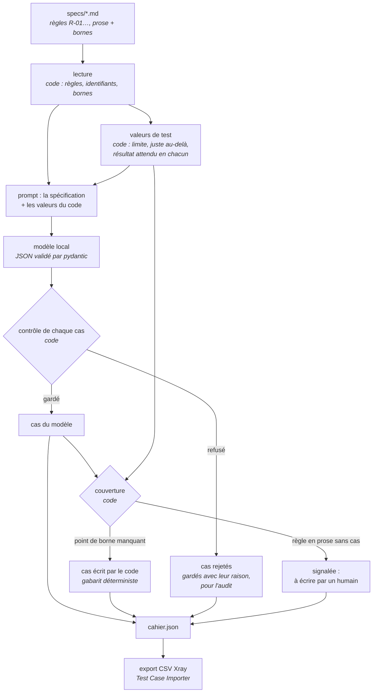
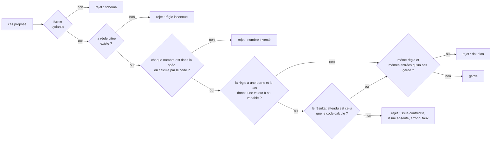

# D'une spécification fonctionnelle à un cahier de tests

Le même principe que le tri des campagnes, appliqué à un autre métier : **le
code calcule et vérifie, le modèle ne fait que proposer.** Ici, le modèle
écrit des cas de test à partir d'une spécification ; le code lit la
spécification, calcule les valeurs limites, refuse tout cas qu'il ne peut pas
tracer, et complète ce qui manque.

Code : [`src/regression_triage/spec_tests/`](../src/regression_triage/spec_tests).
Spécifications de démonstration : [`specs/`](../specs). Résultats mesurés :
[`evals/SPEC_TESTS_RESULTS.md`](../evals/SPEC_TESTS_RESULTS.md).

---

## 1. D'abord un exemple

**La règle.** Dans `specs/tolerance-ecarts-pv.md` :

> **R-04 — Bruit numérique.** Un écart signalé est classé « bruit » quand son
> rapport à la tolérance de son produit est strictement inférieur à 5. À partir
> de 5 fois la tolérance, il est classé « significatif ».
>
> Borne : `rapport_tolerance < 5` · pas 0.01 · si vrai « bruit » · sinon « significatif »

**Ce que le code en tire, avant tout appel au modèle.** La borne est stricte,
donc 5 lui-même n'est pas du bruit :

| Point | `rapport_tolerance` | Résultat attendu |
|---|---|---|
| à la limite | 5 | significatif |
| juste en deçà (un pas de 0.01) | 4.99 | bruit |

**Ce que le modèle a proposé**, sans les valeurs du code (mode `--no-values`,
mesure du 10/11/2026, identique les 3 fois) :

| Cas | Entrées | Attendu |
|---|---|---|
| CT-07 | `ecart_pv` 249.99, `rapport_tolerance` 4.99, « Produit: IRS (tolérance 50) » | bruit |
| CT-08 | `ecart_pv` 250.0, `rapport_tolerance` 5.0, même produit | significatif |

**Ce que le code a refusé.** Les deux cas : 249.99 et 250 ne sont ni dans la
spécification ni dans les valeurs calculées. Raison écrite dans le cahier :
*nombres absents de la spécification et des valeurs calculées par le code :
249.99*. Le premier était faux : 249.99 / 50 = 4.9998, pas 4.99. Un nombre que
le modèle a calculé de tête, et mal. Le second était juste (5 × 50 = 250), mais
le code ne peut pas savoir d'où il vient : refusé aussi. Les deux restent dans
le cahier, sous `rejected`, avec leur raison.

**Ce que le code a écrit à leur place**, depuis le gabarit :
`SPEC-TOL-007 R-04 rapport_tolerance=5 → significatif` et
`SPEC-TOL-008 R-04 rapport_tolerance=4.99 → bruit`, marqués `origin: code`.

**Avec les valeurs du code dans le prompt** (le mode par défaut), le modèle a
écrit directement `rapport_tolerance` 5 → significatif et 4.99 → bruit, sans
écart en euros : gardés tous les deux.

Même règle, deux lectures : le modèle sait ce qu'est un test aux limites, il
ne sait pas calculer de façon sûre ; le code sait calculer, il ne sait pas
écrire les cas des règles en prose. Chacun fait ce qu'il fait bien.

---

## 2. Le principe

| Qui | Fait quoi |
|---|---|
| **Code** | lit la spécification, en extrait les règles et leurs identifiants ; lit les bornes (`Borne :`, `Arrondi :`) ; calcule les deux points de chaque borne (à la limite, juste de l'autre côté) et le résultat attendu en chacun ; vérifie chaque cas proposé ; écrit les points de borne que le modèle a oubliés ; signale les règles que personne n'a couvertes ; exporte le cahier |
| **Modèle local** (Ollama, `qwen3.5:9b`, température 0, graine 42) | propose les cas : la règle visée, les préconditions, les entrées, le résultat attendu, le type (nominal, limite, erreur) |
| **Humain** | écrit les cas des règles en prose que ni le modèle ni le code n'ont couvertes, et relit le sens des cas que le code ne sait pas juger |

### Le chemin d'une spécification



### Ce que le code vérifie, dans l'ordre



Chaque doute penche du côté de l'humain : un cas que le code ne peut pas
vérifier n'est pas cru sur parole, une règle que personne n'a couverte n'est
pas oubliée en silence.

### Les bornes : écrites dans la spécification, calculées par le code

Une règle peut porter une ligne que le code sait lire :

```text
Borne : `|ecart_pv| <= 50.00 EUR` · pas 0.01 · si vrai « accepté » · sinon « signalé »
Arrondi : `arrondi(taux, 4, demi-pair)`
```

Le code en tire deux points, jamais demandés au modèle :

| Borne | À la limite | Juste de l'autre côté |
|---|---|---|
| `x <= s` | `s` → si vrai | `s + pas` → sinon |
| `x >= s` | `s` → si vrai | `s - pas` → sinon |
| `x < s` | `s` → sinon | `s - pas` → si vrai |
| `x > s` | `s` → sinon | `s + pas` → si vrai |
| arrondi à `d` décimales | le premier mi-chemin (`0.005` pour 2) → arrondi selon le mode | le premier nombre de l'autre côté du mi-chemin |

Il calcule aussi quelques valeurs permises en plus (le côté négatif d'une
valeur absolue, une valeur courante de chaque côté, le mi-chemin suivant).
Toutes ces valeurs, et tous les nombres écrits dans la spécification, forment
la liste des nombres qu'un cas a le droit de contenir. C'est l'idée du
garde-fou du mémo (`report.py`), sans toucher à `report.py` : un nombre que
personne n'a écrit ni calculé n'a pas sa place dans un cahier de tests.

Une règle **sans** ligne de borne est de la prose : le code vérifie qu'un cas
la cite et que ses nombres sont traçables, pas ce qu'il dit. Si personne ne
la couvre, elle est signalée. Une ligne qui commence comme une borne mais que
le code ne sait pas lire arrête tout : une borne ignorée en silence serait une
borne jamais testée.

### La vérité, à part

Pour chaque spécification, `specs/verite/<SPEC>.json` donne, écrits à la
main : les règles, les bornes, et les cas que tout bon cahier doit contenir
(dont certains que le code n'exige pas : le côté négatif d'une valeur
absolue, un mi-chemin impair en arrondi bancaire). Ni le modèle ni le paquet
`spec_tests` ne la lisent : seuls les tests et l'évaluation.

---

## 3. Les commandes (PowerShell)

Sans modèle : le code écrit seul ce qu'il sait calculer, et signale le reste.

```powershell
cd regression-triage-agent; $env:PYTHONPATH = "src"; .venv\Scripts\python -m regression_triage.spec_tests specs\tolerance-ecarts-pv.md --judge fake
```

Avec le modèle local (Ollama doit tourner, `qwen3.5:9b` installé) :

```powershell
cd regression-triage-agent; $env:PYTHONPATH = "src"; .venv\Scripts\python -m regression_triage.spec_tests specs\tolerance-ecarts-pv.md --judge ollama
```

Sans donner au modèle les valeurs calculées par le code :

```powershell
cd regression-triage-agent; $env:PYTHONPATH = "src"; .venv\Scripts\python -m regression_triage.spec_tests specs\arrondi-montants.md --judge ollama --no-values
```

Sortie : `runs\spec-tests\<SPEC>.cahier.json` et `runs\spec-tests\<SPEC>.xray.csv`.
Code de sortie : 0 toutes les règles couvertes, 1 spécification illisible,
3 des règles restent à écrire par un humain.

Les tests (sans modèle) et l'évaluation (avec le modèle) :

```powershell
cd regression-triage-agent; .venv\Scripts\python -m pytest tests\test_spec_tests.py -q
```

```powershell
cd regression-triage-agent; .venv\Scripts\python evals\spec_tests_eval.py --reps 3
```

### L'export Xray

Un CSV séparé par des points-virgules, au format du *Test Case Importer* de
Xray : une ligne par pas de test, les lignes d'un même test partagent leur
`TCID`, une colonne répétée donne plusieurs valeurs à un champ. Documentation
publique : <https://docs.getxray.app/display/XRAYCLOUD/Importing+Tests+using+Test+Case+Importer>.
Aucune API Xray n'est appelée : le fichier s'importe à la main, et les
colonnes se relient aux champs Jira dans l'assistant d'import.

| Colonne | Contenu |
|---|---|
| `TCID` | l'identifiant du cas, `SPEC-TOL-001` |
| `Summary` | règle, titre, type, entrées |
| `Description` | spécification et version, préconditions, origine (modèle vérifié, ou code) |
| `Test Type` | `Manual` |
| `Labels` ×3 | la spécification, la règle, le type |
| `Action`, `Data`, `Result` | le pas unique : appliquer la règle, les entrées, le résultat attendu |

---

## 4. Les limites

Mesurées dans [`evals/SPEC_TESTS_RESULTS.md`](../evals/SPEC_TESTS_RESULTS.md) :

- **Le garde-fou de nombres refuse surtout des cas justes.** Sur 39 rejets
  « nombre inventé », 3 arrêtaient une vraie erreur (le 249.99 ci-dessus),
  36 refusaient un cas juste : un écart de 0 pour une règle qui dit « nul » en
  toutes lettres, des arrondis justes sur des valeurs que le modèle avait
  choisies. C'est le prix du principe : ce qui ne se trace pas ne passe pas.
- **Les points d'arrondi du code sont artificiels** (0.005, 0.00005). Le
  modèle partait des exemples de la spécification (2,345 ; 0,03125) : c'était
  lui, le testeur réaliste. Piste : ancrer les points sur le premier exemple
  chiffré de la règle.
- **Le format des bornes est fait pour ce code.** Une vraie spécification en
  prose n'a pas de ligne `Borne :`. Le code n'y calculerait rien et ne
  pourrait que signaler. Faire extraire les bornes par le modèle déplacerait
  le problème : il faudrait faire valider chaque borne extraite par un humain
  avant de s'en servir.
- **Une règle, une borne.** Pas d'intervalle (`3 <= score < 10`) ni de
  priorité entre règles (« sauf si R-01 la bloque déjà ») : chaque cas est
  jugé contre la seule règle qu'il cite.
- **L'issue est lue par mots.** « n'est pas bloquée » se lit « bloquée » :
  le cas est refusé (l'erreur penche vers le rejet, jamais vers l'accord).
- **Les règles en prose ne sont pas jugées sur le fond.** Le code vérifie
  qu'un cas cite la règle et que ses nombres se tracent, pas qu'il dit juste.
  La relecture à la main n'a trouvé aucun cas faux, mais des cas faibles
  (des entrées vides).
- **La couverture des bornes après le code est de 100 % par construction.**
  Le chiffre qui compte est ce que le modèle a fait seul : 54 points sur 66
  avec les valeurs, 36 sans.
- **Quatre spécifications courtes**, écrites par la même personne que la
  vérité et que le code. L'export Xray suit la documentation publique, sans
  avoir été importé dans un vrai Jira.

---

## 5. La phrase pour l'entretien

> « J'ai fait écrire des cahiers de tests à un modèle local à partir de
> spécifications fonctionnelles, mais c'est le code qui lit les règles,
> calcule les valeurs limites et vérifie chaque cas : une règle inventée ou un
> nombre que personne n'a calculé est refusé et gardé pour l'audit, les
> limites oubliées sont écrites par le code, les règles que personne n'a
> couvertes vont à un humain, et le tout sort au format d'import Xray. Mesuré
> sur quatre spécifications, trois fois chacune : 79 % des cas indispensables
> écrits par le modèle seul, 91 % après le code, des sorties identiques d'une
> fois à l'autre ; et j'ai aussi mesuré le prix du garde-fou : sur 39 cas
> refusés pour un nombre inventé, 3 étaient faux. »
